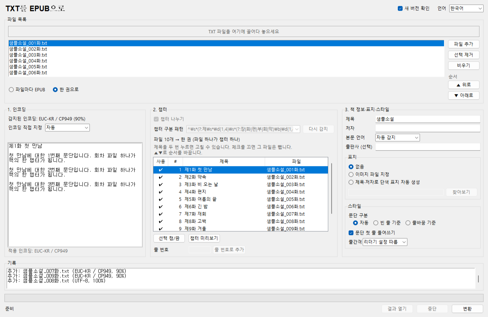
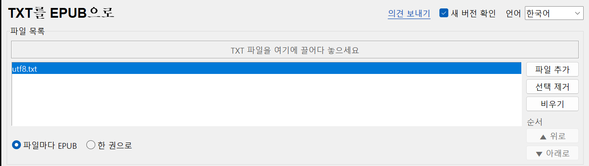

# 书签工具 – TXT转EPUB

[한국어](README.md) · [English](README.en.md) · [日本語](README.ja.md)

把纯文本小说（.txt）转换成可在 Ridipaper、Crema、Kindle 上阅读的 EPUB。自动识别编码（EUC-KR、CP949、UTF-8、UTF-16），自动分割章节。也可以把每话一个文件的多个 TXT 合成一本书。无服务器（仅检查新版本例外，可关闭）、无需安装、不修改原文件。


## 下载

- **可执行文件**：在 [Releases](https://github.com/microhan1/txt-to-epub/releases) 下载 `txt-to-epub.exe` 并双击运行，无需安装。文件未签名，若 SmartScreen 弹出警告，请选择"更多信息 → 仍要运行"。
- **从源码运行**：

```bash
pip install -r requirements.txt
python main.py
```

## 使用方法

1. 把 TXT 文件拖到窗口中。程序会识别编码并预览开头部分；如果显示乱码，可当场更换编码。
2. 检查识别出的章节列表。取消误判的项目，用行号补上漏掉的章节。
3. 设置书名、作者、正文语言、封面和样式，按 **转换**，即在原文件旁生成 `<原文件名>.epub`。

也可以在命令行使用：

```bash
python main.py novel.txt --encoding auto --chapter-pattern "^第.+章" --title "书名" --author "作者" --lang zh --cover cover.jpg
```

`python main.py --help` 会按操作系统语言（한국어 · English · 中文 · 日本語）显示选项。`--lang` 是正文语言（EPUB 的 `dc:language`），界面语言用 `--ui-lang`。

## 多个 TXT 合成一本书

每话一个文件的网络小说文件夹可以合成一本书。把文件夹（或多个文件）拖进来，在文件列表下方选 **合成一本**，就会得到一个 EPUB，每个文件是一章。**每个文件一个EPUB**（默认）与以前相同。

- **顺序**：文件名中的数字按数值比较，`2话` 排在 `10话` 前面。用 ▲ ▼（或 Alt+↑↓）调整。
- **章节标题**：文件名去掉所有文件共有的部分（系列名）后的剩余部分（`小说_001话_觉醒.txt` → `001话 觉醒`）。如果文件第一行就是该标题，或者像 `第1话` 这样是章节标题的形式，就用那一行做标题，正文中不再重复。在第 2 步的列表里双击标题可修改，取消勾选则不包含该文件。
- **书名**：拖入一个文件夹时为文件夹名，拖入多个文件时为文件名的共有部分。结果保存为第一个文件所在文件夹下的 `<书名>.epub`。
- 编码按文件分别识别（EUC-KR 和 UTF-8 的分话混在一起也可以）。此方式不在文件内部套用章节模式：一个文件就是一章。



*图：放入 10 个分话文件并选中 **合成一本** 后的画面；第 2 步按顺序把文件列为章节。界面为韩语。*

命令行用 `--merge`。省略 `--output` 时，保存为第一个文件所在文件夹下的 `<书名>.epub`。

```bash
python main.py 小说文件夹 --merge --title "书名" --author "作者" --output "书名.epub"
```

## 章节模式示例

去掉首尾空白后，行以模式**开头**且不超过 80 个字符时，视为章节标题。因此 `第1章 启程` 这样编号后面带副标题的行也能识别，但正文句子若以 `序章` 或 `1. ` 开头，也可能被误认为章节；在列表中取消勾选该项，它就会并入上一章的正文。默认模式可识别下面所有形式，也可以输入自己的正则表达式。模式列表在 `patterns.json` 中。

| 语言 | 示例 |
|---|---|
| 韩语 | `제1장 시작`、`12화` |
| 英语 | `Chapter 7`、`CHAPTER XII. The Pool of Tears` |
| 中文 | `第3章`、`第十二回` |
| 日语 | `第3話 帰郷`、`プロローグ` |

## 检查新版本

启动时为了确认是否有新版本，只把工具名（`txttoepub`）和版本号发送到书签服务器（chaekgalpi.co.kr）。不发送文件，每天只检查一次，可在设置中关闭（顶部的 **检查新版本** 复选框）。检查在窗口显示后于后台进行，无法连接时不显示任何内容。

有新版本时，窗口底部会出现一行提示。按 **更新** 打开书签工具页面；按 **以后** 则不再提示该版本（有更新的版本时会再次提示）。不会自动下载或替换。


*图：提示行画面。用伪造的服务器响应（新版本 0.2.0）显示的测试画面，界面为韩语。*

## 发送反馈

问题、不便之处或想要的功能，可以通过窗口上方的 **发送反馈** 或 [https://chaekgalpi.co.kr/en/tools/txttoepub#feedback](https://chaekgalpi.co.kr/en/tools/txttoepub#feedback)（英文页面）提交，无需登录。程序只是用浏览器打开该页面，自己不发送任何内容。[GitHub Issues](https://github.com/microhan1/txt-to-epub/issues) 也照常接收。



*图：窗口右上方的「의견 보내기」（发送反馈）链接，界面为韩语。*

## 不做的事

- 不生成 EPUB3、MOBI、AZW3，只生成 EPUB2。
- 不做拼写纠错，不修改文字。
- 含图片的文档（HTML、DOCX）不在范围内。
- 不解除 DRM，不抓取网络小说。
- 不会自动下载或替换新版本。

## 系列

- 书签工具：[扫描PDF清晰化 (scan-pdf-cleanup)](https://github.com/microhan1/scan-pdf-cleanup) · [裁边 (TrimPDF)](https://github.com/microhan1/TrimPDF) · [跨页拆分 (spread-split)](https://github.com/microhan1/spread-split) · [添加目录书签 (pdf-toc-add)](https://github.com/microhan1/pdf-toc-add)
- [书签图书馆（Chaekgalpi Library）](https://chaekgalpi.co.kr/en/tools/txttoepub?utm_source=github&utm_medium=referral&utm_campaign=tool_cta&utm_content=txttoepub) — 记录读过的书和读书笔记的网页服务（仅韩语）

## 许可证

MIT。见 [LICENSE](LICENSE)。

发布的 exe 还包含 Python、Tcl/Tk 等第三方组件，组件及其许可证全文见 [THIRD_PARTY_LICENSES.txt](THIRD_PARTY_LICENSES.txt)。
